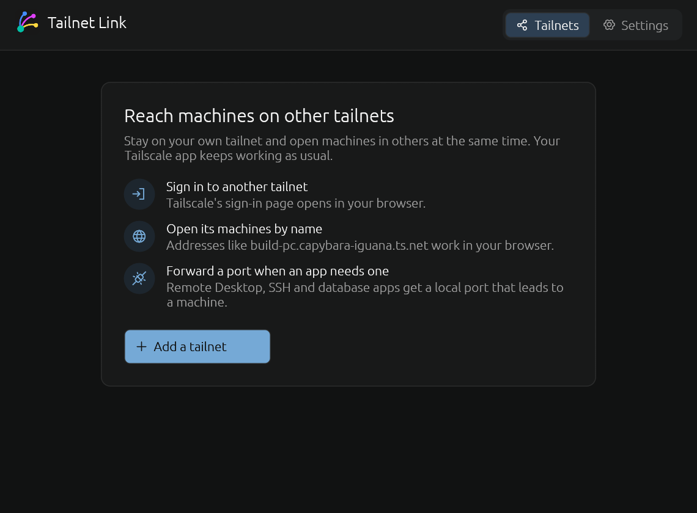
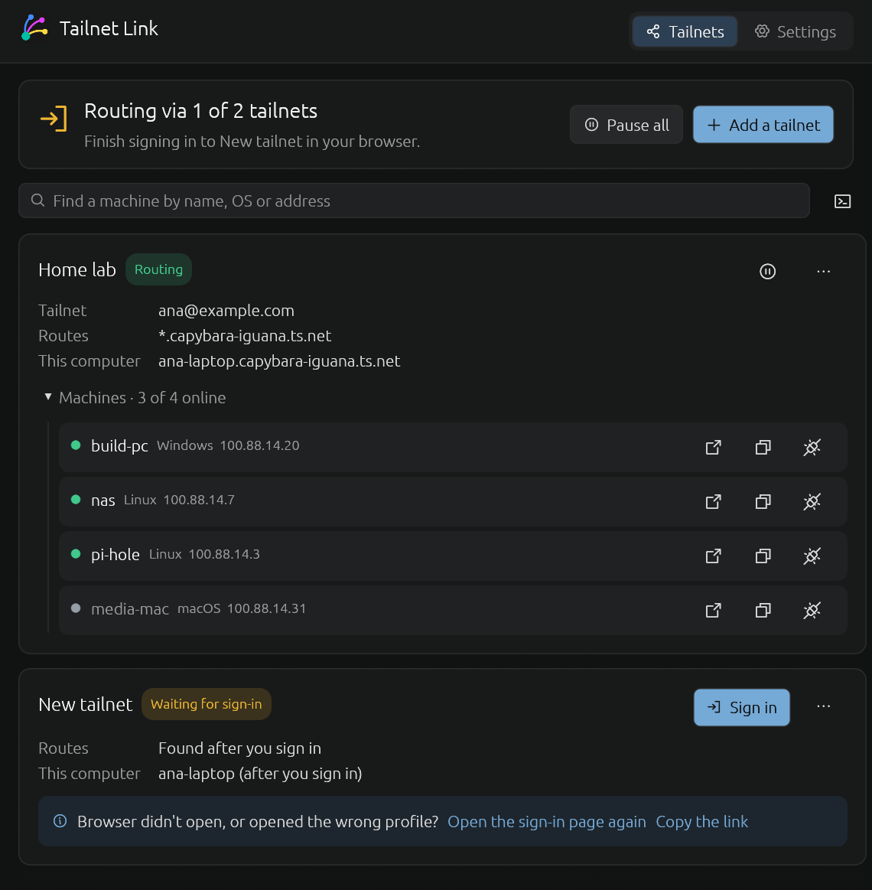
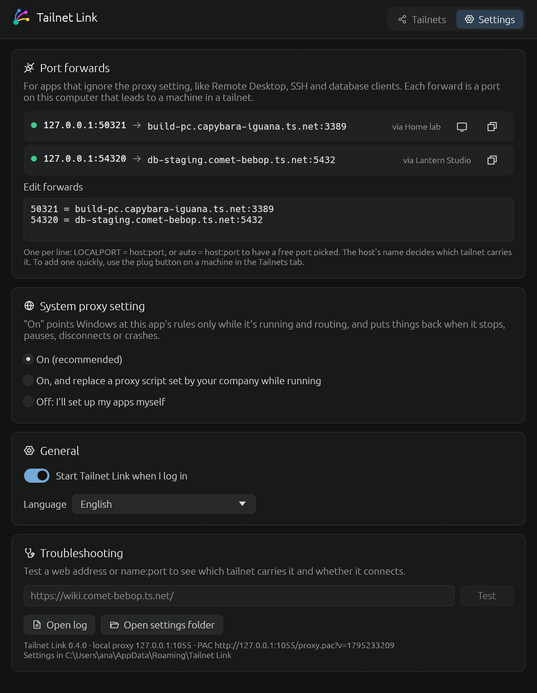

# Tailnet Link

[](https://github.com/Azazel-Labs/tailnet-link/actions/workflows/ci.yml)
[](https://github.com/Azazel-Labs/tailnet-link/releases)
[](LICENSE)
[](Cargo.toml)
[](Cargo.toml)
[](#download)

<!-- languages:start -->
English · [Afrikaans](docs/i18n/README.af.md) · [Català](docs/i18n/README.ca.md) · [Čeština](docs/i18n/README.cs.md) · [Dansk](docs/i18n/README.da.md) · [Deutsch](docs/i18n/README.de.md) · [Ελληνικά](docs/i18n/README.el.md) · [Español (Latinoamérica)](docs/i18n/README.es-419.md) · [Español (España)](docs/i18n/README.es-ES.md) · [Suomi](docs/i18n/README.fi.md) · [Français](docs/i18n/README.fr.md) · [Magyar](docs/i18n/README.hu.md) · [Bahasa Indonesia](docs/i18n/README.id.md) · [Italiano](docs/i18n/README.it.md) · [日本語](docs/i18n/README.ja.md) · [한국어](docs/i18n/README.ko.md) · [Norsk bokmål](docs/i18n/README.nb.md) · [Nederlands](docs/i18n/README.nl.md) · [Polski](docs/i18n/README.pl.md) · [Português (Brasil)](docs/i18n/README.pt-BR.md) · [Português (Portugal)](docs/i18n/README.pt-PT.md) · [Română](docs/i18n/README.ro.md) · [Русский](docs/i18n/README.ru.md) · [Српски](docs/i18n/README.sr-Cyrl.md) · [Svenska](docs/i18n/README.sv.md) · [ไทย](docs/i18n/README.th.md) · [Türkçe](docs/i18n/README.tr.md) · [Українська](docs/i18n/README.uk.md) · [Tiếng Việt](docs/i18n/README.vi.md) · [简体中文](docs/i18n/README.zh-Hans.md) · [繁體中文](docs/i18n/README.zh-Hant.md)
<!-- languages:end -->


**Stay on your own tailnet. Reach machines on every other one, at the same time.**

Tailscale lets you be signed in to one tailnet at a time. If your home lab, your company and a client
each have their own, you keep switching accounts, and whatever you were connected to drops. Tailnet
Link ends that. Your Tailscale app stays exactly where it is, and Tailnet Link quietly adds the other
tailnets beside it, so `https://wiki.comet-bebop.ts.net/` and `build-pc.capybara-iguana.ts.net` both
just open.

**[Download the latest release](https://github.com/Azazel-Labs/tailnet-link/releases/latest)** for
Windows, macOS or Linux. It's free and open source.


*Screenshots use made-up tailnets; every name and address in them is invented.*

## Why Tailnet Link

- **No more account switching.** Add as many tailnets as you need and use them all at once. Your
  own tailnet never disconnects.
- **Nothing to configure.** Sign in, and the tailnet's domain is found for you. Open its machines by
  name in any browser.
- **Finds the websites on your machines.** Machines that serve an HTTPS page show up as tiles with
  the page's name and icon, one click away. Each machine is checked at most once a day.
- **Doesn't fight Tailscale.** No VPN adapter, no routes, no DNS changes. Each extra tailnet runs as
  a separate node inside the app, so nothing clashes with the Tailscale app or with each other.
- **Locked down by default.** Every extra node joins with shields up: you can reach those tailnets,
  and nothing in them can reach your computer.
- **Only their traffic goes through it.** Addresses in your other tailnets go through Tailnet Link.
  Everything else goes direct, exactly as before.
- **Works with apps that ignore proxies.** Remote Desktop, SSH and database clients get a local port
  that leads to the machine, in one click.
- **Cleans up after itself.** The system proxy setting is only on while something is routing, and is
  put back on quit, pause, crash or power cut.
- **Speaks your language.** The interface is translated into 31 languages.

## How it works

1. **Add a tailnet.** Tailscale's own sign-in page opens in your browser, just like with the
   Tailscale app.
2. **Its domain is picked up automatically.** After you sign in, Tailnet Link reads the tailnet's
   MagicDNS name (for example `capybara-iguana.ts.net`) and routes `*.capybara-iguana.ts.net` through it.
3. **Open its machines.** Type a name in your browser, or pick a machine from the list to open it,
   copy its address or forward a port to it.

| First run | Signing in |
|---|---|
|  |  |

Under the hood:

- For each tailnet you add, the app runs a **separate Tailscale node inside itself**
  ([libtailscale](https://github.com/tailscale/libtailscale), in userspace).
- **One local port serves them all** (127.0.0.1:1055, or a free one if that's taken). The proxy reads
  the name in each request and sends it through the tailnet that owns it.
- The **system proxy setting** points at a PAC file that lists only what those tailnets reach: their
  domains, their machines' addresses (`100.x.y.z`), machines shared in from other tailnets, and the
  subnets their subnet routers share (for example a cloud network, `192.168.0.0/16`). Anything else
  never touches the app.
- An address in two of your tailnets at once (two tailnets sharing the same private range, say) is
  ambiguous, so it isn't routed. **Test a name or address** says so. Turning off one tailnet's
  subnets settles it.
- HTTPS works end to end with the real certificates. The proxy never sees inside it.
- Terminal tools don't read the system proxy setting. Put [`tl`](#in-a-terminal-tl) in front of
  them, or test a machine in **Settings → Test a name or address**.

### Names of your own

A server behind a subnet router has only an address. In **Settings → Names**, give it a name, one per
line: `wiki = 192.168.20.15`. Then `http://wiki:8080/` opens it in your browser, and port
forwards can use the name too. Names work only on this computer, through Tailnet Link.

### Apps that ignore proxies

Browsers and most tools follow the system proxy setting. Remote Desktop, database clients and similar
apps don't. For those, click the plug button next to a machine and pick a port: a free local port is
chosen and kept, and you connect to `127.0.0.1:<that port>`. On Windows, Remote Desktop forwards get
their own **Open Remote Desktop** button.


You can also edit forwards by hand in Settings, one per line, for example
`auto = build-pc.capybara-iguana.ts.net:3389`.

### In a terminal: `tl`

Command-line tools don't read the system proxy setting. `tl`, installed with the app, sets things up
for one command:

```sh
tl curl http://wiki.capybara-iguana.ts.net/
tl git clone https://git.capybara-iguana.ts.net/team/app.git
tl ssh admin@build-pc.capybara-iguana.ts.net
tl ping build-pc.capybara-iguana.ts.net
```

Run `tl` on its own for a shell where every command works that way. Its prompt starts with `(tl)`,
and `exit` leaves it. The **terminal button** on the Tailnets tab opens a new terminal window with that shell.

- **Most tools** follow the standard proxy variables that `tl` sets (`HTTPS_PROXY` and the rest):
  curl, wget, git, npm, pip, cargo, Go, Python and Node.js. Your tailnets' names go through them, and
  everything else goes directly, as it would without `tl`.
- **`ssh`, `scp` and `sftp`** connect through `tl` (an SSH `ProxyCommand`), and so does git over SSH.
  A `ProxyJump` or `ProxyCommand` you set up yourself is kept.
- **`tl ping`** uses Tailscale's own ping and shows whether the connection is direct or relayed.
  `-c 10` sends 10 pings and `-t` keeps going. An address behind a subnet router is answered by the
  router. A name outside your tailnets gets the normal `ping`.
- When you `ssh` somewhere from a `tl` shell, the remote shell is a normal shell: nothing is passed
  along.
- Tools that use neither the variables nor SSH still can't reach these tailnets. Forward a port to
  them instead (see above).

To have this in every terminal, add a line to your shell's profile. It does nothing while Tailnet Link
isn't running:

| Shell | Profile line |
|---|---|
| bash (`~/.bashrc`) | `eval "$(tl --env bash 2>/dev/null)"` |
| zsh (`~/.zshrc`) | `eval "$(tl --env zsh 2>/dev/null)"` |
| fish (`~/.config/fish/config.fish`) | `tl --env fish 2>/dev/null \| source` |
| PowerShell (`$PROFILE`) | `tl --env powershell 2>$null \| Out-String \| Invoke-Expression` |

The proxy variables point at Tailnet Link, so a terminal set up that way can't reach the internet
after you quit Tailnet Link. Open a new terminal then. A `tl` shell has the same limit, but `exit` ends
it.

The Windows installer puts `tl` on the `PATH`. The Linux package installs it as `/usr/bin/tl`. On a
Mac, link it from the app: `sudo ln -s "/Applications/Tailnet Link.app/Contents/MacOS/tl"
/usr/local/bin/tl`.

## Everything at a glance

**Tailnets tab**

- Overall status, **Pause all** and **Add a tailnet**.
- A **terminal** button, next to the machine search, that opens a terminal where your tailnets' names
  work (see [`tl`](#in-a-terminal-tl)).
- **Websites** found on the machines, as tiles with each page's title and icon. Click one to open
  it, or right-click to copy its address. Click the star on a tile to make it a favorite: favorites
  come first, as large tiles with a picture of the page. The picture is taken once a day by Edge,
  Chrome, Chromium or Brave, whichever is installed, running hidden in a throwaway profile and only
  through Tailnet Link, so a site that needs a sign-in shows its sign-in page. The card shows two
  rows (more if you have more favorites) and a **Show all** link.
  A warning sign means the site's certificate isn't trusted (often a self-signed one). Each machine
  is asked once a day, a few at a time; the refresh button asks again now.
- One card per tailnet, with its status, routed domains and subnets, and this computer's name there.
  Sign in or log out, pause or resume, rename it, add extra domains, turn its subnets off, or remove
  it.
- Each signed-in tailnet lists its **machines**, online first. The list starts folded away and
  remembers whether you opened it. Search filters them by name, OS or address. For each machine you can **open** it in your browser, **copy** its name, or **forward a
  port** to it.
- If the sign-in page didn't open, or opened in the wrong browser profile, the card offers to open it
  again or copy the link.

**Settings tab**



- The **version** you're running, with **Check now** to look for a newer one, then **start at
  login**, **checking for new versions**, **looking for websites** on your machines, and the
  interface **language**.
- **Port forwards**, each with its local address, a copy button, and which tailnet carries it (or
  why it can't).
- **Names** of your own for addresses in your tailnets, such as `wiki = 192.168.20.15`.
- The **system proxy setting**.
- **Test a name or address** shows which tailnet routes it and tries to connect through it. It's the
  quickest way to find out why a page won't load.
- Unsaved changes are flagged, with **Revert**. Ctrl+S saves, and Esc closes dialogs.

**Tray menu:** status; one line per tailnet (click to sign in if needed); Add a tailnet…; master
on/off; Open Tailnet Link…; Quit. Left-click the icon to open the window. Closing the window keeps
Tailnet Link running in the tray (the menu bar on macOS).

**Icon colors:** green = routing, amber = a tailnet needs sign-in, gray = paused or connecting,
red = problem.

## The proxy setting is only on while it should be

| What happens | Result |
|---|---|
| Quit, or log off normally | Setting restored immediately |
| Everything paused, logged out or disconnected | Setting switched off until something routes again, and the PAC falls back to "everything direct". On a Mac that needs a password for proxy changes, the setting stays until you quit to avoid repeated prompts, but the PAC is all-direct. |
| The app crashes or is killed | A small watchdog (the same program, hidden) notices and restores the setting |
| Power cut or forced reboot | Restored at your next login, and on the app's next start |

It never replaces a proxy script someone else set (for example your company's) unless you choose
"replace" in Settings. It always puts the previous one back, and leaves alone any change made in the
meantime.

## Platforms

| | Windows | macOS | Linux |
|---|---|---|---|
| Window + tray | ✅ | ✅ (menu bar, no Dock icon) | ✅ (GNOME needs the AppIndicator extension; Ubuntu has it) |
| Sets the system proxy | ✅ | ✅ (may ask for an admin password at start and quit) | ✅ GNOME and KDE |
| Start at login | ✅ | ✅ | ✅ |

Firefox on any platform: Settings → Network Settings → **Use system proxy settings**.

## Download

Get the [latest release](https://github.com/Azazel-Labs/tailnet-link/releases/latest).

| File | For |
|---|---|
| **`tailnet-link-windows-setup.exe`** | **Windows installer** (x64; also runs on ARM64 Windows via emulation) |
| **`tailnet-link-macos-universal.dmg`** | **Mac** (Apple Silicon and Intel) |
| **`tailnet-link-linux-amd64.deb`** | **Ubuntu / Debian**: `sudo apt install ./tailnet-link-linux-amd64.deb` |
| `tailnet-link-windows-amd64.exe`, `-macos-universal.zip`, `-linux-amd64` | The app without an installer |

`SHA256SUMS.txt` lists checksums for every file.

**Not code-signed.** On Windows, at the SmartScreen warning choose **More info → Run anyway**. On
macOS, right-click the app and choose **Open** the first time.

### What the Windows installer does

- Installs for all users in `C:\Program Files\Tailnet Link`. It asks for admin once and needs nothing
  else installed.
- Adds a Windows Firewall rule for this app only (inbound UDP), so the other tailnets connect directly
  instead of through Tailscale's relays, without an "allow access" pop-up.
- Adds a Start menu shortcut, an optional desktop shortcut, and **Start at login** (on by default;
  starts quietly in the tray).
- Puts `tl` on the `PATH` (on by default), so it works in every new terminal.
- Upgrades in place and keeps logins and settings.
- Uninstalling closes the app, restores the proxy setting, removes the firewall rule, login item and
  `PATH` entry, and asks before deleting logins.
- Silent install: `tailnet-link-windows-setup.exe /S`. Silent uninstall:
  `"C:\Program Files\Tailnet Link\uninstall.exe" /S`.

## Files

Everything lives in the app's config folder:

| Windows | macOS | Linux |
|---|---|---|
| `%AppData%\Tailnet Link` | `~/Library/Application Support/Tailnet Link` | `~/.config/tailnet-link` |

- `config.json`: your tailnets, port forwards and settings
- `nodes/<id>/`: each tailnet's login (Remove deletes it)
- `sites.json`: which machines have a website, so each is only asked again after a day
- `tailnet-link.log`: the log, including the details of any crash
- `proxy-state.json` (macOS/Linux, only while the proxy setting is on): what to restore

Set `TAILNET_LINK_CONFIG_DIR` to use a different folder.

Upgrading from **tailnet-proxy**, this app's earlier name? Your old `tailnet-proxy` config folder is
moved to the new location the first time Tailnet Link starts, so logins and settings carry over.

## Contributing

Tailnet Link is written in Rust with an [egui](https://github.com/emilk/egui) window, on top of
Tailscale's [libtailscale](https://github.com/tailscale/libtailscale). Build instructions and the
project layout are in [docs/development.md](docs/development.md), the release process is in
[docs/releases.md](docs/releases.md), and [docs/translations.md](docs/translations.md) explains how to
improve a translation or add a language.

## License

Copyright © 2026 Azazel Labs LLC. Released under [MIT-0](LICENSE).

`tsbridge/` is vendored from [tailscale/libtailscale](https://github.com/tailscale/libtailscale) and
keeps its BSD-3-Clause license (see [tsbridge/LICENSE](tsbridge/LICENSE)). Tailnet Link is not made by
or affiliated with Tailscale Inc. Tailscale is a trademark of Tailscale Inc.
