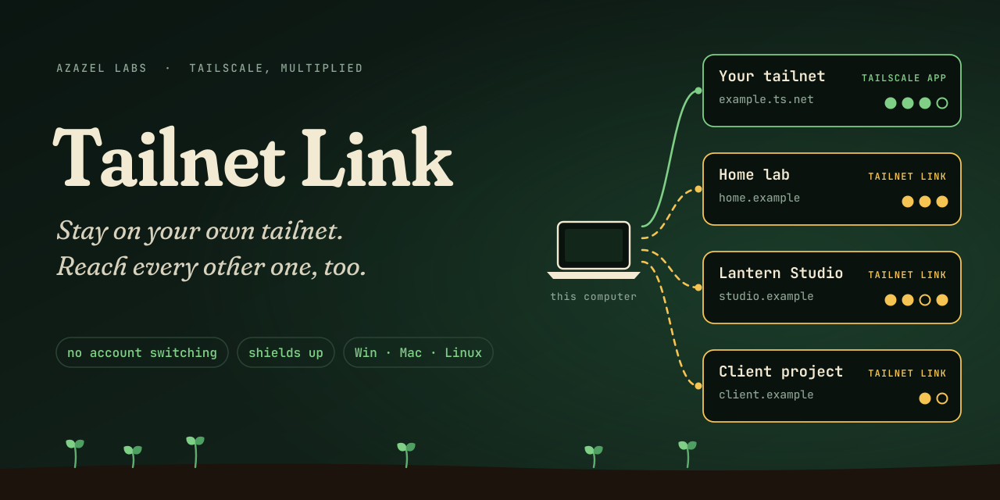

# Tailnet Link

[English](../../README.md) · [Afrikaans](README.af.md) · [Català](README.ca.md) · [Čeština](README.cs.md) · Dansk · [Deutsch](README.de.md) · [Ελληνικά](README.el.md) · [Español (Latinoamérica)](README.es-419.md) · [Español (España)](README.es-ES.md) · [Suomi](README.fi.md) · [Français](README.fr.md) · [Magyar](README.hu.md) · [Bahasa Indonesia](README.id.md) · [Italiano](README.it.md) · [日本語](README.ja.md) · [한국어](README.ko.md) · [Norsk bokmål](README.nb.md) · [Nederlands](README.nl.md) · [Polski](README.pl.md) · [Português (Brasil)](README.pt-BR.md) · [Português (Portugal)](README.pt-PT.md) · [Română](README.ro.md) · [Русский](README.ru.md) · [Српски](README.sr-Cyrl.md) · [Svenska](README.sv.md) · [ไทย](README.th.md) · [Türkçe](README.tr.md) · [Українська](README.uk.md) · [Tiếng Việt](README.vi.md) · [简体中文](README.zh-Hans.md) · [繁體中文](README.zh-Hant.md)

**Bliv på dit eget tailnet. Nå maskiner på alle de andre, på samme tid.**

Med Tailscale kan du kun være logget ind på ét tailnet ad gangen. Har dit hjemmelab, din arbejdsplads og en kunde hver deres, skifter du konto igen og igen, og det, du var forbundet til, ryger. Det gør Tailnet Link en ende på. Din Tailscale-app bliver lige, hvor den er, og Tailnet Link tilføjer stille og roligt de andre tailnets ved siden af, så både `https://wiki.comet-bebop.ts.net/` og `build-pc.capybara-iguana.ts.net` bare åbner.

**[Hent den nyeste udgivelse](https://github.com/Azazel-Labs/tailnet-link/releases/latest)** til Windows, macOS eller Linux. Gratis og open source.

*Skærmbillederne viser opdigtede tailnets; alle navne og adresser i dem er opfundet.*

## Hvorfor Tailnet Link

- **Slut med at skifte konto.** Tilføj så mange tailnets, du har brug for, og brug dem alle på én gang. Dit eget tailnet afbrydes aldrig.
- **Intet at konfigurere.** Log ind, så findes tailnettets domæne for dig. Åbn dets maskiner ved navn i en hvilken som helst browser.
- **Kommer ikke i vejen for Tailscale.** Ingen VPN-adapter, ingen ruter, ingen DNS-ændringer. Hvert ekstra tailnet kører som en separat node inde i appen.
- **Låst ned som standard.** Hver ekstra node tilslutter sig med skjoldene oppe: du kan nå de tailnets, men intet i dem kan nå din computer.
- **Kun deres trafik går igennem.** Adresser i dine andre tailnets går gennem Tailnet Link. Alt andet går direkte, præcis som før.
- **Virker med apps, der ignorerer proxyer.** Fjernskrivebord, SSH og databaseklienter får med ét klik en lokal port, der fører til maskinen.
- **Rydder op efter sig.** Systemets proxyindstilling er kun slået til, mens noget dirigeres, og sættes tilbage ved afslutning, pause, nedbrud eller strømsvigt.
- **Taler dit sprog.** Brugerfladen findes på 31 sprog.

## Sådan virker det

1. **Tilføj et tailnet.** Tailscales egen login-side åbner i din browser, præcis som med Tailscale-appen.
2. **Domænet findes automatisk.** Når du har logget ind, læser Tailnet Link tailnettets MagicDNS-navn (f.eks. `capybara-iguana.ts.net`) og dirigerer `*.capybara-iguana.ts.net` gennem det.
3. **Åbn dets maskiner.** Skriv et navn i din browser, eller vælg en maskine på listen for at åbne den, kopiere dens adresse eller videresende en port til den.

## Apps, der ignorerer proxyer

Browsere og de fleste værktøjer følger systemets proxyindstilling. Fjernskrivebord, databaseklienter og lignende apps gør ikke. Klik så på stikknappen ved en maskine, og vælg en port: en ledig lokal port vælges og beholdes, og du forbinder til `127.0.0.1:<port>`. På Windows får videresendelser til Fjernskrivebord deres egen knap, **Åbn Fjernskrivebord**.

## Platforme og download

Tailnet Link kører på Windows (vindue og meddelelsesområde), macOS (menulinjen) og Linux (GNOME og KDE). Hent **`tailnet-link-windows-setup.exe`** til Windows, **`tailnet-link-macos-universal.dmg`** til Mac eller **`tailnet-link-linux-amd64.deb`** til Ubuntu og Debian (`sudo apt install ./tailnet-link-linux-amd64.deb`) fra [den nyeste udgivelse](https://github.com/Azazel-Labs/tailnet-link/releases/latest).

Appen er **ikke kodesigneret**. På Windows vælger du **Flere oplysninger → Kør alligevel** ved SmartScreen-advarslen. På macOS højreklikker du på appen og vælger **Åbn** første gang.

## Mere information

Alle detaljer, bl.a. hvordan proxyindstillingen håndteres, hvor filerne ligger, og hvad Windows-installationsprogrammet gør, står i [den engelske README](../../README.md). Forbedringer af oversættelsen er meget velkomne: se [docs/translations.md](../../docs/translations.md).

Copyright © 2026 Azazel Labs LLC. Udgivet under [MIT-0](../../LICENSE). Tailnet Link er ikke lavet af eller tilknyttet Tailscale Inc. Tailscale er et varemærke tilhørende Tailscale Inc.
