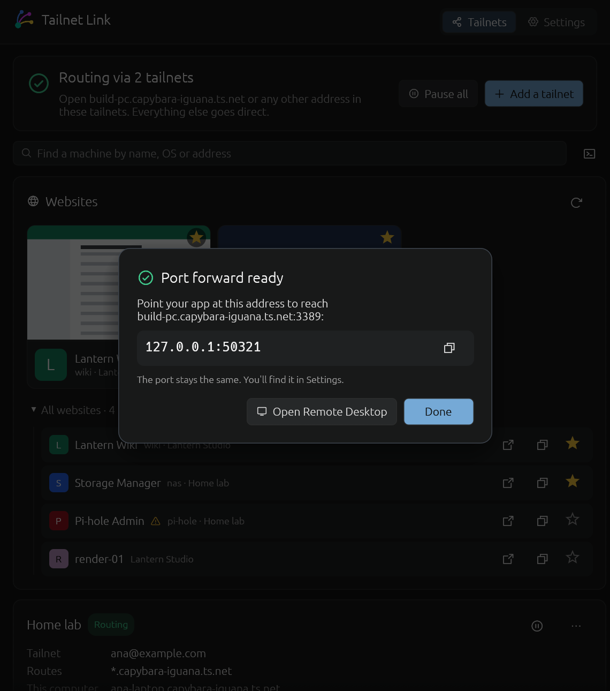

# Tailnet Link

[](https://github.com/Azazel-Labs/tailnet-link/actions/workflows/ci.yml)
[](https://github.com/Azazel-Labs/tailnet-link/releases)
[](../../LICENSE)
[](../../Cargo.toml)
[](../../Cargo.toml)
[](../../README.md#download)

[English](../../README.md) · [Afrikaans](README.af.md) · [Català](README.ca.md) · [Čeština](README.cs.md) · [Dansk](README.da.md) · [Deutsch](README.de.md) · [Ελληνικά](README.el.md) · [Español (Latinoamérica)](README.es-419.md) · [Español (España)](README.es-ES.md) · Suomi · [Français](README.fr.md) · [Magyar](README.hu.md) · [Bahasa Indonesia](README.id.md) · [Italiano](README.it.md) · [日本語](README.ja.md) · [한국어](README.ko.md) · [Norsk bokmål](README.nb.md) · [Nederlands](README.nl.md) · [Polski](README.pl.md) · [Português (Brasil)](README.pt-BR.md) · [Português (Portugal)](README.pt-PT.md) · [Română](README.ro.md) · [Русский](README.ru.md) · [Српски](README.sr-Cyrl.md) · [Svenska](README.sv.md) · [ไทย](README.th.md) · [Türkçe](README.tr.md) · [Українська](README.uk.md) · [Tiếng Việt](README.vi.md) · [简体中文](README.zh-Hans.md) · [繁體中文](README.zh-Hant.md)


**Pysy omassa tailnetissäsi. Käytä kaikkien muiden koneita samaan aikaan.**

Tailscalessa voit olla kirjautuneena vain yhteen tailnetiin kerrallaan. Jos kotilaboratoriollasi, työpaikallasi ja asiakkaallasi on kullakin omansa, vaihdat tiliä jatkuvasti, ja yhteys siihen, mitä juuri käytit, katkeaa. Tailnet Link lopettaa sen. Tailscale-sovelluksesi pysyy juuri siinä missä on, ja Tailnet Link lisää muut tailnetit huomaamattomasti sen rinnalle, joten sekä `https://wiki.comet-bebop.ts.net/` että `build-pc.capybara-iguana.ts.net` yksinkertaisesti avautuvat.

**[Lataa uusin julkaisu](https://github.com/Azazel-Labs/tailnet-link/releases/latest)** Windowsille, macOS:lle tai Linuxille. Ilmainen ja avointa lähdekoodia.


*Kuvakaappausten tailnetit ovat keksittyjä; kaikki niissä näkyvät nimet ja osoitteet ovat kuvitteellisia.*

## Miksi Tailnet Link

- **Ei enää tilinvaihtoa.** Lisää niin monta tailnetiä kuin tarvitset ja käytä niitä kaikkia yhtä aikaa. Oman tailnetisi yhteys ei katkea koskaan.
- **Ei mitään määritettävää.** Kirjaudu sisään, niin tailnetin verkkotunnus löytyy puolestasi. Avaa sen koneet nimellä missä tahansa selaimessa.
- **Löytää koneidesi verkkosivustot.** Koneet, jotka tarjoavat HTTPS-sivun, näkyvät ruutuina sivun nimellä ja kuvakkeella, yhden napsautuksen päässä. Jokainen kone tarkistetaan enintään kerran päivässä.
- **Ei riitele Tailscalen kanssa.** Ei VPN-sovitinta, ei reittejä, ei DNS-muutoksia. Jokainen lisätailnet toimii sovelluksen sisällä omana solmunaan.
- **Lukittu oletuksena.** Jokainen lisäsolmu liittyy kilvet ylhäällä: sinä pääset noihin tailneteihin, mutta mikään niissä ei pääse tietokoneellesi.
- **Vain niiden liikenne kulkee sen kautta.** Muiden tailnetiesi osoitteet kulkevat Tailnet Linkin kautta. Kaikki muu kulkee suoraan, aivan kuten ennenkin.
- **Toimii välityspalvelimen ohittavien sovellusten kanssa.** Etätyöpöytä, SSH ja tietokantaohjelmat saavat yhdellä napsautuksella paikallisen portin, joka johtaa koneeseen.
- **Toimii myös päätteessä.** Lisää `tl` komentojen curl, git, ssh tai ping eteen, tai suorita pelkkä `tl`, niin saat komentotulkin, jossa tailnetiesi nimet toimivat.
- **Siivoaa jälkensä.** Järjestelmän välityspalvelinasetus on käytössä vain, kun jotain reititetään, ja se palautetaan, kun sovellus suljetaan, keskeytetään tai kaatuu tai sähköt katkeavat.
- **Puhuu kieltäsi.** Käyttöliittymä on käännetty 31 kielelle.

## Näin se toimii

1. **Lisää tailnet.** Tailscalen oma kirjautumissivu avautuu selaimessa, aivan kuten Tailscale-sovelluksessa.
2. **Verkkotunnus haetaan automaattisesti.** Kun olet kirjautunut, Tailnet Link lukee tailnetin MagicDNS-nimen (esimerkiksi `capybara-iguana.ts.net`) ja reitittää osoitteet `*.capybara-iguana.ts.net` sen kautta.
3. **Avaa sen koneet.** Kirjoita nimi selaimeen tai valitse kone listasta: avaa se, kopioi sen osoite tai ohjaa siihen portti.

## Sovellukset, jotka ohittavat välityspalvelimen

Selaimet ja useimmat työkalut noudattavat järjestelmän välityspalvelinasetusta. Etätyöpöytä, tietokantaohjelmat ja vastaavat sovellukset eivät. Napsauta silloin koneen vieressä olevaa pistokepainiketta ja valitse portti: vapaa paikallinen portti valitaan ja säilytetään, ja yhdistät osoitteeseen `127.0.0.1:<portti>`. Windowsissa Etätyöpöydän edelleenohjauksilla on oma **Avaa Etätyöpöytä** -painike.



## Päätteessä

Komentorivityökalut eivät lue järjestelmän välityspalvelinasetusta. Lisää sovelluksen mukana asentuva `tl` komennon eteen, tai suorita pelkkä `tl`, niin saat komentotulkin, jossa tailnetiesi nimet toimivat. **Tailnetit**-välilehden päätepainike avaa sellaisen.

```sh
tl curl http://wiki.capybara-iguana.ts.net/
tl ssh admin@build-pc.capybara-iguana.ts.net
tl ping build-pc.capybara-iguana.ts.net
```

Näin toimivat curl, git, npm, pip ja useimmat muut työkalut sekä ssh, scp ja sftp. `tl ping` käyttää Tailscalen omaa pingiä. Yksityiskohdat löytyvät [englanninkielisestä README-tiedostosta](../../README.md#in-a-terminal-tl).

## Alustat ja lataus

Tailnet Link toimii Windowsissa (ikkuna ja ilmaisinalue), macOS:ssä (valikkorivi) ja Linuxissa (GNOME ja KDE). Lataa [uusimmasta julkaisusta](https://github.com/Azazel-Labs/tailnet-link/releases/latest) Windowsille **`tailnet-link-windows-setup.exe`**, Macille **`tailnet-link-macos-universal.dmg`** tai Ubuntulle ja Debianille **`tailnet-link-linux-amd64.deb`** (`sudo apt install ./tailnet-link-linux-amd64.deb`).

Sovellusta **ei ole allekirjoitettu koodiallekirjoituksella**. Valitse Windowsissa SmartScreen-varoituksen kohdalla **Lisätietoja → Suorita silti**. Napsauta macOS:ssä ensimmäisellä kerralla sovellusta hiiren oikealla painikkeella ja valitse **Avaa**.

## Lisätietoja

Kaikki yksityiskohdat, kuten välityspalvelinasetuksen toiminta, tiedostojen sijainnit ja Windows-asennusohjelman toimet, löytyvät [englanninkielisestä README-tiedostosta](../../README.md). Käännösparannukset ovat erittäin tervetulleita: katso [docs/translations.md](../../docs/translations.md).

Copyright © 2026 Azazel Labs LLC. Julkaistu [MIT-0](../../LICENSE)-lisenssillä. Tailnet Link ei ole Tailscale Inc.:n tekemä eikä siihen sidoksissa. Tailscale on Tailscale Inc.:n tavaramerkki.
