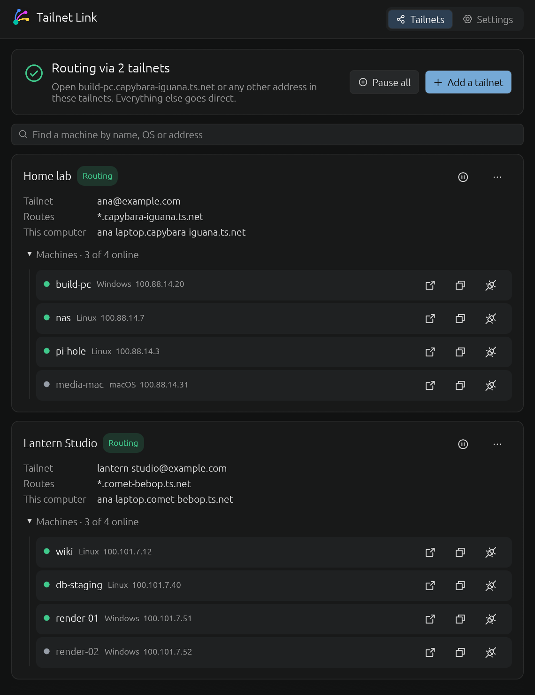

# Tailnet Link

[English](../../README.md) · [Afrikaans](README.af.md) · [Català](README.ca.md) · [Čeština](README.cs.md) · [Dansk](README.da.md) · [Deutsch](README.de.md) · [Ελληνικά](README.el.md) · [Español (Latinoamérica)](README.es-419.md) · [Español (España)](README.es-ES.md) · [Suomi](README.fi.md) · [Français](README.fr.md) · [Magyar](README.hu.md) · Bahasa Indonesia · [Italiano](README.it.md) · [日本語](README.ja.md) · [한국어](README.ko.md) · [Norsk bokmål](README.nb.md) · [Nederlands](README.nl.md) · [Polski](README.pl.md) · [Português (Brasil)](README.pt-BR.md) · [Português (Portugal)](README.pt-PT.md) · [Română](README.ro.md) · [Русский](README.ru.md) · [Српски](README.sr-Cyrl.md) · [Svenska](README.sv.md) · [ไทย](README.th.md) · [Türkçe](README.tr.md) · [Українська](README.uk.md) · [Tiếng Việt](README.vi.md) · [简体中文](README.zh-Hans.md) · [繁體中文](README.zh-Hant.md)

**Tetap di tailnet Anda sendiri. Jangkau mesin di semua tailnet lain, pada saat yang sama.**

Tailscale hanya mengizinkan Anda masuk ke satu tailnet dalam satu waktu. Jika lab rumahan, kantor, dan klien Anda masing-masing punya tailnet sendiri, Anda harus terus berganti akun, dan apa pun yang sedang terhubung akan terputus. Tailnet Link mengakhiri itu. Aplikasi Tailscale Anda tetap seperti apa adanya, sementara Tailnet Link diam-diam menambahkan tailnet lain di sampingnya, sehingga `https://wiki.comet-bebop.ts.net/` dan `build-pc.capybara-iguana.ts.net` sama-sama langsung terbuka.

**[Unduh rilis terbaru](https://github.com/Azazel-Labs/tailnet-link/releases/latest)** untuk Windows, macOS, atau Linux. Gratis dan sumber terbuka.

*Tangkapan layar memakai tailnet rekaan; semua nama dan alamat di dalamnya fiktif.*

## Mengapa Tailnet Link

- **Tak perlu lagi berganti akun.** Tambahkan tailnet sebanyak yang Anda perlukan dan gunakan semuanya sekaligus. Tailnet Anda sendiri tidak pernah terputus.
- **Tanpa konfigurasi.** Cukup masuk, dan domain tailnet ditemukan untuk Anda. Buka mesin-mesinnya berdasarkan nama di browser apa pun.
- **Tidak bentrok dengan Tailscale.** Tanpa adaptor VPN, tanpa rute, tanpa perubahan DNS. Setiap tailnet tambahan berjalan sebagai node terpisah di dalam aplikasi, sehingga tidak ada yang bertabrakan dengan aplikasi Tailscale maupun satu sama lain.
- **Terkunci secara bawaan.** Setiap node tambahan bergabung dengan shields up: Anda dapat menjangkau tailnet tersebut, tetapi tidak ada apa pun di sana yang dapat menjangkau komputer Anda.
- **Hanya lalu lintas mereka yang lewat.** Alamat di tailnet Anda yang lain melewati Tailnet Link. Selebihnya berjalan langsung, persis seperti sebelumnya.
- **Bekerja dengan aplikasi yang mengabaikan proksi.** Desktop Jarak Jauh, SSH, dan klien basis data mendapat port lokal yang mengarah ke mesin, dengan sekali klik.
- **Membereskan jejaknya sendiri.** Pengaturan proksi sistem hanya aktif selama ada yang dirutekan, dan dikembalikan saat keluar, dijeda, mogok, atau listrik padam.
- **Berbicara dalam bahasa Anda.** Antarmukanya diterjemahkan ke 31 bahasa.

## Cara kerjanya

1. **Tambahkan tailnet.** Halaman masuk Tailscale sendiri terbuka di browser Anda, sama seperti dengan aplikasi Tailscale.
2. **Domainnya dideteksi otomatis.** Setelah Anda masuk, Tailnet Link membaca nama MagicDNS tailnet tersebut (misalnya `capybara-iguana.ts.net`) dan merutekan `*.capybara-iguana.ts.net` melaluinya.
3. **Buka mesin-mesinnya.** Ketik nama di browser, atau pilih mesin dari daftar untuk membukanya, menyalin alamatnya, atau meneruskan port ke mesin itu.

## Aplikasi yang mengabaikan proksi

Browser dan sebagian besar alat mengikuti pengaturan proksi sistem, tetapi Desktop Jarak Jauh, klien basis data, dan aplikasi sejenis tidak. Untuk aplikasi tersebut, klik tombol colokan di samping mesin dan pilih port: port lokal yang kosong dipilih dan disimpan, lalu Anda terhubung ke `127.0.0.1:<port>`. Di Windows, penerusan Desktop Jarak Jauh punya tombol **Buka Desktop Jarak Jauh** tersendiri.

## Unduhan dan platform

Tailnet Link berjalan di Windows, macOS, dan Linux (GNOME dan KDE). Di [rilis terbaru](https://github.com/Azazel-Labs/tailnet-link/releases/latest) tersedia penginstal Windows `tailnet-link-windows-setup.exe`, `tailnet-link-macos-universal.dmg` untuk Mac (Apple Silicon dan Intel), dan `tailnet-link-linux-amd64.deb` untuk Ubuntu dan Debian (`sudo apt install ./tailnet-link-linux-amd64.deb`).

**Tidak ditandatangani secara digital.** Di Windows, pada peringatan SmartScreen pilih **Info selengkapnya → Tetap jalankan** (More info → Run anyway). Di macOS, klik kanan aplikasi dan pilih **Buka** saat pertama kali.

## Selengkapnya

Semua detail (pengaturan, menu baki, pemulihan pengaturan proksi, penginstal Windows, lokasi file) ada di [README bahasa Inggris](../../README.md). Untuk memperbaiki terjemahan, lihat [docs/translations.md](../../docs/translations.md).

Hak cipta © 2026 Azazel Labs LLC. Dirilis di bawah lisensi [MIT-0](../../LICENSE). Tailnet Link tidak dibuat oleh dan tidak berafiliasi dengan Tailscale Inc. Tailscale adalah merek dagang Tailscale Inc.
